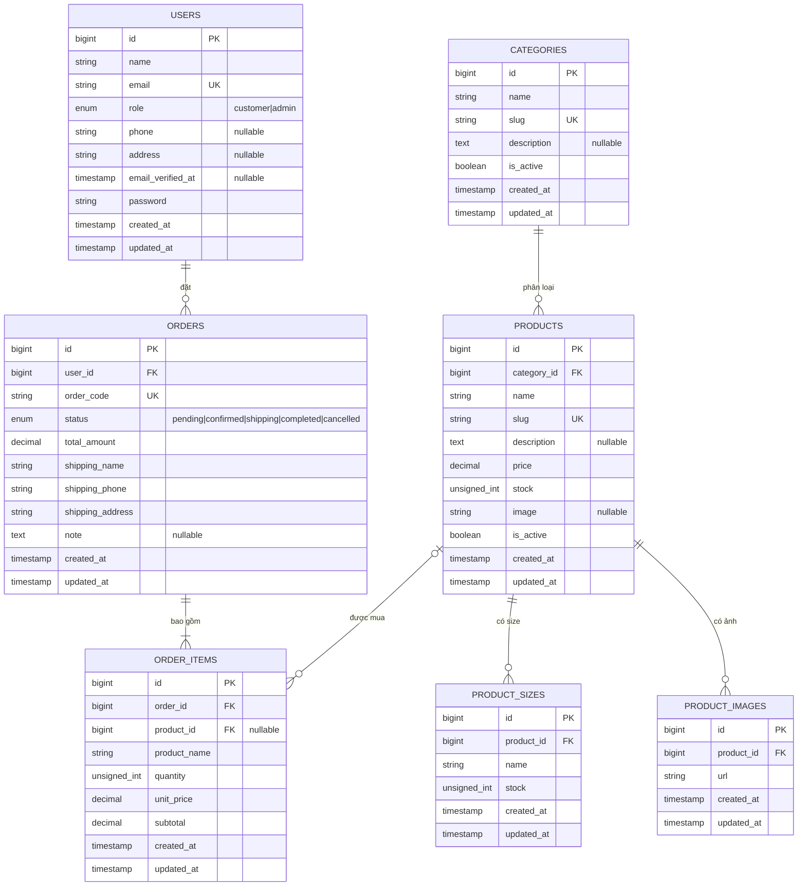

# ERD - CNW Clothing

Sơ đồ thực thể - liên kết của các bảng nghiệp vụ hiện có trong hệ thống:

## Diễn giải quan hệ

- Một **user** có thể đặt nhiều **order**; mỗi order thuộc về đúng một user.
- Một **category** có thể chứa nhiều **product**; mỗi product thuộc về đúng một category.
- Một **product** có thể có nhiều **size** và nhiều **ảnh**. Ảnh được lưu bằng URL
  bên ngoài, không upload file lên máy chủ.
- Một **order** phải có ít nhất một **order item**.
- Một **order item** tham chiếu đến một product, nhưng `product_id` có thể rỗng nếu sản phẩm đã bị xóa.
- `product_name`, `unit_price` và `subtotal` trong `order_items` lưu lại dữ liệu tại thời điểm đặt hàng, giúp bảo toàn lịch sử đơn hàng.
- Xóa category bị giới hạn nếu còn product (`restrictOnDelete`).
- Xóa order sẽ xóa các order item liên quan (`cascadeOnDelete`).
- Xóa product sẽ giữ order item nhưng đặt `product_id` thành rỗng (`nullOnDelete`).

## Bảng Laravel kỹ thuật

Các bảng `sessions`, `password_reset_tokens`, `cache`, `cache_locks`, `jobs`,
`job_batches` và `failed_jobs` phục vụ framework, không nằm trong ERD nghiệp vụ
chính.
